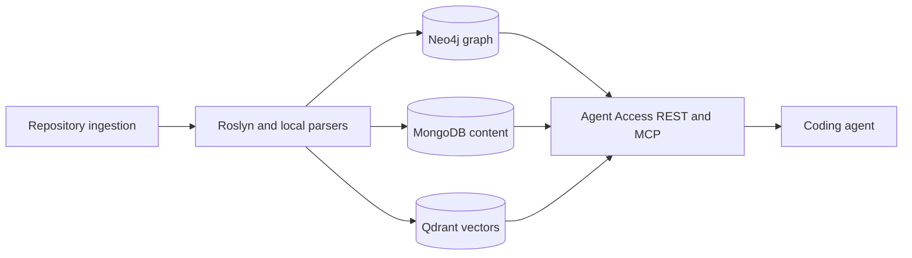

# CodeMesh

CodeMesh is a local-first, C#/.NET-focused context and change-impact service
that helps coding agents locate implementation, trace likely impact, and select
validation using compact, source-backed evidence.

The current milestone is to establish repeatable evidence that the
configured/onboarded workflow improves agent outcomes over normal repository
exploration. CodeMesh is not presented as production-ready. The CodeMesh source
is available under the [MIT License](LICENSE).

## Product status

| Status | Capability |
| --- | --- |
| Implemented and locally verified | C# ingestion through Roslyn; atomic multi-language ingestion; bounded Python and Rust parsing with PyO3 links; graph/content persistence; stable checkout identity and bounded local snapshots; exact checkout binding and fail-closed freshness; REST, MCP, CLI, and .NET Agent Access; normal and diagnostic MCP profiles; reviewable installation and provider-free probes; agent feedback recording and summarization; source-backed context packages; deterministic fixture evaluation; security redaction tests. |
| Optional and environment-dependent | Neo4j, MongoDB, and Qdrant stores; Docker Compose; embeddings through a configured local provider; Python, Rust, Markdown, and deployment-artifact parsing with narrower relationships than C#. |
| Retained, bounded evidence | Summary-free live retrieval passed on two repositories; assisted campaigns replicated utility after explicit onboarding; spontaneous and prompt-parity campaigns recorded zero CodeMesh adoption; the provider-free one\|nine Primary pilot passed its local retrieval, safety, and feedback gates. These results do not establish broad generalization. |
| Experimental or unqualified | Generated summaries, online model providers, model-selection benchmarks, and the read-only local web UI as a product surface. No summary model is CodeMesh-qualified. |
| Planned | Configured/onboarded normal-host evaluation, feedback-driven bounded expansion, configurable ingestion allow/deny policy, shared-service identity controls, and broader parser and SDLC coverage. |

Passing tests establish the covered local behavior. They do not establish
hosted CI success, generalized agent benefit, release readiness, deployment
acceptance, or production fitness. See
[Project Status](docs/current/project-status.md) for the reviewed evidence
position and [Next Steps](docs/planning/next-steps.md) for
execution order.

## Architecture



Graph paths, generated summaries, and search rankings are navigation evidence.
The cited repository source remains authoritative.

## Five-minute local demonstration

Prerequisites are the .NET 10 SDK, Docker Compose, Python 3.12 or newer, and
[`uv`](https://docs.astral.sh/uv/). The demonstration indexes this checkout, so
it needs no external sample repository or model provider.

1. Create local configuration and set a unique development password:

   ```powershell
   Copy-Item .env.example .env
   # Edit .env and set CODEMESH_NEO4J_AUTH=neo4j/<random-local-password>
   ```

   On Unix-like shells, use `cp .env.example .env` instead. `.env` is ignored by
   Git. The example keeps model and summary providers disabled.

2. Start the local stores and parser, then ingest CodeMesh without embeddings or
   generated summaries:

   ```powershell
   docker compose up -d neo4j mongodb qdrant csharp-parser agent-access
   dotnet restore CodeMesh.sln --locked-mode
   dotnet run --project src/CodeMesh.Cli -- self ingest --skip-embeddings
   ```

3. Query the repository through Agent Access:

   ```powershell
   Set-Location agent-access
   uv sync --locked
   uv run python -m codemesh_agent_access package `
     "How does self ingestion reach the stores?" `
     --repository-id code_mesh `
     --output agent
   ```

The generated alias is normally `code_mesh`; confirm it with
`dotnet run --project src/CodeMesh.Cli -- repos list` if needed. For a
store-free contract demonstration, run
`uv run python -m codemesh_agent_access eval` from `agent-access`; that suite
uses synthetic in-process fixtures and proves tool behavior, not retrieval from
a live index.

## What this demonstrates

- .NET 10 and Roslyn-based semantic parsing for C# implementation and local
  relationships.
- Python FastAPI, MCP, CLI, ranking, formatting, and store read paths.
- Neo4j graph, MongoDB content/registry, and optional Qdrant vector storage.
- Docker Compose service wiring with host ports restricted to loopback by
  default.
- Source-scoped MCP context packages with freshness and redaction diagnostics.
- Deterministic fixture, live retrieval, and opt-in agent/model evaluation
  layers with explicit evidence boundaries.
- Local-first processing by default; generated summaries and external model
  providers are opt-in and unqualified.

## Verification

Use the supported invocations in [`COMMANDS.md`](COMMANDS.md) and select them
with the risk-scaled rules in [Testing](docs/evaluation/testing.md). Current
status and retained product evidence are summarized in
[Project Status](docs/current/project-status.md); dated results apply only to the
commits they identify.

## Repository map

- `src/CodeMesh.Parser.CSharp`: Roslyn parser worker.
- `src/CodeMesh.Ingestion`: ingestion, cleanup, redaction, embeddings, and
  optional summary generation.
- `src/CodeMesh.Storage`: Neo4j, MongoDB, Qdrant, and in-memory adapters.
- `src/CodeMesh.Control` and `src/CodeMesh.Cli`: configuration, lifecycle, and
  operator commands.
- `agent-access`: Python REST, MCP, CLI, ranking, and evaluation surfaces.
- `tests/CodeMesh.Tests` and `agent-access/tests`: .NET and Python verification.
- `COMMANDS.md`: supported contributor and coding-agent command index.

Start with [Agent Quickstart](docs/guides/agent-quickstart.md) when working in the
repository. The [Documentation Hub](docs/README.md) organizes current
references, guides, status, evidence, engineering policy, and future proposals.

## Security, contribution, and licence

Read [SECURITY.md](SECURITY.md) before reporting a suspected secret or
vulnerability, [CONTRIBUTING.md](CONTRIBUTING.md) before proposing changes, and
the [Code of Conduct](CODE_OF_CONDUCT.md) when participating in the project.

CodeMesh is licensed under the [MIT License](LICENSE). Third-party packages,
services, and referenced evaluation repositories retain their own licences; see
[Third-party Notices](THIRD_PARTY_NOTICES.md). The dated
[Publication Readiness Review](docs/history/publication-readiness-2026-08-11.md) is retained as
historical evidence for its recorded checkout, not as current readiness status.
