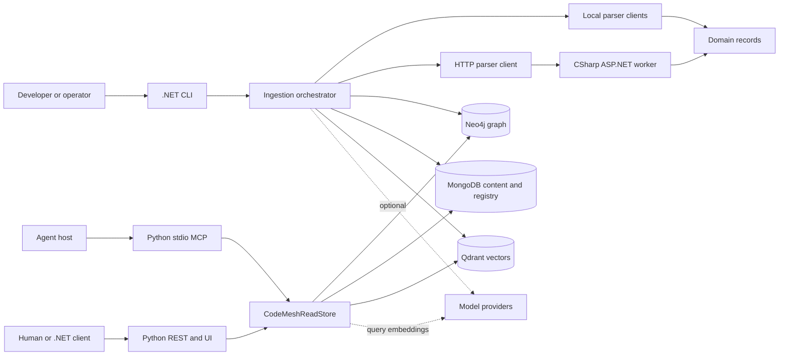

# CodeMesh Architecture

Document type: current implementation reference

CodeMesh is organized around a write-side ingestion pipeline and a read-side Agent Access surface.

For a progressive introduction and glossary, start with the
[Developer handbook](../guides/developer-handbook.md). This page owns component
boundaries and code navigation; linked chapters explain the algorithms.

## Product Boundary

The architecture is service-capable, but the initial product wedge is narrower:
source-grounded context and change-impact support for agents working in C#/.NET
repositories. The primary agent questions are:

- Where is the relevant implementation?
- What code and behavior are likely affected by this change?
- Which tests and validation commands provide the best evidence?

Freshness, repository scoping, source spans, and compact context packages are
part of the core product. Generated summaries, embeddings, additional parser
languages, deployment intelligence, UI expansion, and broader SDLC artifacts
are optional enrichments until controlled evaluation shows that they improve
agent outcomes. Graph paths and generated summaries remain navigation evidence,
not source truth.

## High-Level Flow

1. A repository is selected through CLI options or configuration.
2. One parser worker or an exact language-set composite emits code nodes,
   relationships, diagnostics, and source spans.
3. Ingestion computes a deterministic snapshot id, stages graph records, source content, vector embeddings, generated summaries, repository registry records, and ingestion run records under that snapshot namespace.
4. The registry atomically publishes checkout-current and eligible clean branch-head slots; failed or stale generations do not replace active slots.
5. Agent Access resolves a project, alias, or snapshot reference to an active snapshot and reads the stores through REST, MCP tools, Python CLI commands, and the .NET client.
6. Agents consume context search results, context packages, symbols, nodes, neighbors, repository metadata, and ingestion history while editing code.

## Components

### Domain

`src/CodeMesh.Domain` contains shared contracts and stable records used across the solution:

- Parser contracts.
- Ingestion contracts.
- Agent Access contracts.
- Graph types.
- Health contracts.
- Hashing, fingerprinting, and repository alias utilities.
- A shared repository path policy for excluding generated, cache, virtual-environment, smoke, and temporary directories.
- Default known-secret-file exclusion plus repository-relative allow and deny
  patterns shared by parsing, snapshot identity, refresh, and watch.
- Fail-closed exclusion of symlink, junction, and reparse-point path components
  below the selected repository root, including discovered and explicitly
  selected C# solution/project manifests.

### Ingestion

`src/CodeMesh.Ingestion` coordinates repository ingestion:

- Calls parser workers.
- Canonicalizes selected language sets and merges every parser result before
  computing or publishing one snapshot; parser errors abort publication.
- Handles dry-run and persistent ingestion modes.
- Resolves persistent project, alias, and checkout identity from private
  Git/local markers.
- Computes deterministic source snapshots and stages cross-store generations.
- Includes the effective path-policy version and normalized filter configuration
  in snapshot identity.
- Publishes checkout-current and clean branch-head slots with compare-and-swap semantics.
- Writes graph, content, vector, summary, registry, and run data.
- Performs incremental skip logic for unchanged records.
- Removes stale records from previous runs.
- Marks unreferenced snapshots collectible and supports retryable cross-store garbage collection.
- Supports local embedding providers plus local and online summary providers.
- Assigns versioned summary complexity tiers from node kind, source size,
  truncation, and available parser metadata; the selected token budgets are
  persisted with each generated summary.
- Runs summary-model qualification through the same prompt, parser, budget,
  provider, and redaction path; records immutable suite/profile/source identity,
  emits restricted blinded-review artifacts, and compiles sanitized reports
  only after compatible live-retrieval evidence is bound.

### Parser Workers

`src/CodeMesh.Parser.CSharp` is the C# parser worker:

- Exposes `/health`, `/capabilities`, and `/parse`.
- Uses Roslyn to parse solutions and projects. Its container runtime includes
  the .NET SDK required by `MSBuildWorkspace`; HTTP health alone does not prove
  project loading. Standard design-time outputs are isolated in request-owned
  temporary directories in the container, preserving compiler metadata and the
  read-only source mount. See the [runtime decision](../decisions/0004-parser-container-requires-dotnet-sdk.md)
  and [output-isolation decision](../decisions/0005-isolate-parser-design-time-outputs.md).
- Emits file, test file, namespace, declaration, type, member, test case, and relationship nodes.
- Represents partial types as logical symbols plus declaration nodes.
- Detects common .NET test attributes and CodeMesh-style `Test...` methods in test files as `TestCase` nodes.
- Emits local semantic relationships such as `Invokes`, `Reads`, and `Writes`.

`src/CodeMesh.Parser.Python` is the local Python parser:

- Parses `.py` files from a repository root.
- Emits file, class, function, async function, import, and test-case nodes.
- Emits containment relationships based on indentation.
- Handles multiline definition headers, repeated guarded imports, local calls,
  and calls through imported aliases.
- Uses the shared repository path policy to exclude generated/cache directories such as `.venv`, `.tmp`, `__pycache__`, `.pytest_cache`, smoke output, and build output.
- Does not provide complete dynamic-import, data-flow, or type resolution.

`src/CodeMesh.Parser.Rust` is the local Rust parser:

- Parses `.rs` files from a repository root while excluding Cargo `target`.
- Emits module, struct, enum, trait, impl, function, method, `use`, and test-case
  nodes with source spans and content hashes.
- Emits containment, implementation, reference, invocation, and type-use
  relationships.
- Records PyO3 module, class, function, and exported-name metadata. Composite
  Python/Rust ingestion links unambiguous static Python imports and calls to
  those exports.
- Uses source-structural matching rather than rustc semantic analysis; macro,
  dynamic-import, and conditional-compilation resolution remain bounded.

`src/CodeMesh.Parser.Deployment` is the local deployment artifact parser:

- Parses Dockerfiles and Docker Compose files from a repository root.
- Emits Dockerfile, Dockerfile stage, Compose file, and Compose service nodes.
- Captures runtime metadata such as base images, build contexts, ports, environment keys, volumes, and service dependencies.
- Emits containment relationships and `depends_on` service relationships.
- Uses the shared repository path policy to avoid generated, cache, virtual-environment, smoke, and temporary directories.
- Does not yet parse Kubernetes manifests, Helm charts, CI/CD workflows, or Compose override merge semantics.

`src/CodeMesh.Parser.Markdown` is the local Markdown parser:

- Parses `.md` and `.markdown` files from a repository root.
- Emits document and section nodes.
- Emits containment relationships from documents to headings and from parent headings to child headings.
- Stores heading level, anchor, file path, and document kind metadata.
- Uses the shared repository path policy to exclude generated, cache, virtual-environment, smoke, and temporary directories.

### Storage

`src/CodeMesh.Storage` contains write and read adapters:

- Neo4j for graph nodes and relationships.
- MongoDB for content, repository registry, ingestion runs, and node summaries.
- Qdrant for vector embeddings.
- In-memory storage for tests.
- Neo4j node and relationship upserts are split into bounded auto-commit batches
  so large repositories do not require one graph-sized transaction. Snapshot
  slots remain unpublished until all store writes complete.

### Control And CLI

`src/CodeMesh.Control` and `src/CodeMesh.Cli` provide operator-facing behavior:

- Environment file loading.
- Workspace/configuration helpers.
- Status and doctor checks.
- Typed Agent Access .NET client.
- Single- and multi-language ingestion, repository, run, summary, and embedding
  verification commands. Refresh and watch preserve the canonical language set.

### Agent Access

`agent-access` is the Python read surface for agents:

- FastAPI REST endpoints.
- Profile-selected MCP tool manifests and handlers; the default normal-user
  profile exposes the four package-first read tools, while the diagnostic
  profile adds non-destructive inspection tools. Explicitly activated
  development-feedback and feedback-maintainer profiles add bounded local
  packet recording or allowlisted read-only intake without changing either
  existing profile.
- Python CLI commands.
- Store read paths for graph, content, summaries, vectors, repositories, and ingestion runs.
- Context ranking, formatting, and package generation.
- Exact normal-profile project/checkout/root/source-view binding. Bound tools
  inject the selected project and reject caller overrides or stale, dirty,
  mismatched, missing, and ambiguous checkout state.
- A hashed installation planner/applier that forwards environment variable
  names rather than secret values, plus provider-free stdio probes that check
  the exact launch command, profile tool surface, binding, session identity,
  freshness, or feedback discovery as applicable. Installation-plan v2 pins
  feedback session path and hash while retaining v1 normal-plan loading.
- A versioned local feedback recorder, validator, and prioritizing summarizer,
  plus immutable development-session manifests and revocation records. V2 MCP
  packets derive repository, binding, snapshot/parser availability, session,
  and CodeMesh provenance in the server. Maintainer intake scans only
  allowlisted outboxes and deterministically hashes non-authorizing resolution
  drafts. Raw prompts, payloads, source excerpts, credentials, and environment
  values are not retained.

## Main Data Stores

- Graph: snapshot-namespaced code structure and relationships in Neo4j.
- Content: content-addressed source snippets with snapshot references in MongoDB.
- Vectors: snapshot-namespaced semantic embeddings in Qdrant.
- Summaries: snapshot-namespaced generated node summaries in MongoDB.
- Registry: projects, checkouts, snapshots, observations, slots, generations,
  repository metadata, and ingestion run history in MongoDB.

## Current Extension Points

- Add parser workers for more languages and artifact types.
- Add storage adapters behind existing contracts.
- Add Agent Access tools for new query patterns.
- Add context package enrichers for documentation, deployment, test, and SDLC metadata.
- Add model providers for embeddings and summaries.

These are existing seams, not an execution plan. Changes still follow
[Next Steps](../planning/next-steps.md) or explicit owner direction.

## Processes and dependency direction

The arrows show calls, not a requirement to start every process. Local parsing
is the default in the CLI. The C# HTTP worker is an alternative parser boundary.
The Python MCP process and REST process each construct their own read facade;
MCP does not relay requests through REST. Both use the same stores. Normal MCP
needs local filesystem access to the bound checkout for freshness.

The composition root is
[CLI Program.cs](../../src/CodeMesh.Cli/Program.cs): `RunIngestAsync` constructs
parsers, stores, and providers explicitly and injects their contracts into
`IngestionOrchestrator`. There is no ingestion dependency-injection container.
The [C# worker Program.cs](../../src/CodeMesh.Parser.CSharp/Program.cs) registers
`CSharpParseService` as a singleton in ASP.NET and passes request cancellation
to `ParseAsync`.

At the project-reference level, all parser projects depend on Domain. Storage
depends on Domain; Ingestion depends on Domain and Storage contracts; Control
depends on Domain. CLI references and composes these projects. These boundaries
are visible in the [CLI project](../../src/CodeMesh.Cli/CodeMesh.Cli.csproj),
[Ingestion project](../../src/CodeMesh.Ingestion/CodeMesh.Ingestion.csproj), and
[Control project](../../src/CodeMesh.Control/CodeMesh.Control.csproj). Parser
selection belongs in CLI; persistence decisions belong in Ingestion and Storage.

Python startup enters
[cli.main](../../agent-access/codemesh_agent_access/cli.py).
`rest` starts Uvicorn with `rest.app`; `mcp` starts the stdio server.
[dependencies.get_settings/get_store](../../agent-access/codemesh_agent_access/dependencies.py)
cache one settings object and facade per process. The REST lifespan closes the
owned stores; `mcp.run` delegates its lifetime to FastMCP's `server.run` and has
no equivalent explicit `close_store` hook. Mongo's synchronous operations
are dispatched through `asyncio.to_thread`, while the graph adapter uses the
async Neo4j driver. This means changing an environment variable in a running
process does not reconstruct its cached settings.

## Project and package map

| Location | Responsibility and useful starting symbols | Representative validation |
| --- | --- | --- |
| [CodeMesh.Domain](../../src/CodeMesh.Domain/) | `CodeNode`, `ParseRequest`, `SnapshotPublication`, `RepositoryPathPolicy`; shared contracts and fingerprints. | `TestHash`, path-policy tests, `TestAgentAccessContractsMapRestJson`. |
| [CodeMesh.Cli](../../src/CodeMesh.Cli/Program.cs) | Dispatch, `RunIngestAsync`, `CreateParserClient`, `RunRefreshAsync`, `RunWatchAsync`, provider/store factories. | Workflow argument tests and end-to-end smoke. |
| [CodeMesh.Control](../../src/CodeMesh.Control/) | `EnvironmentFileLoader`, `CodeMeshWorkspace`, refresh/watch helpers, `CodeMeshStatusService`, `AgentAccessClient`. | Environment, workflow, status, and client tests. |
| [CodeMesh.Ingestion](../../src/CodeMesh.Ingestion/) | `IngestionOrchestrator`, `CompositeParserClient`, identities, cleanup, providers and qualification. | Incremental, multi-language, redaction, snapshot, and summary tests. |
| [CodeMesh.Parser.CSharp](../../src/CodeMesh.Parser.CSharp/CSharpParseService.cs) | `LoadProjectContextsAsync`, `ExtractDeclarationNodes`, `ExtractRelationships`; local and HTTP use of Roslyn. | Compile-item, partial-declaration, cross-project-call tests. |
| [Other parsers](ingestion-internals.md#parser-specific-mechanisms) | Python, Rust, Markdown, and deployment `ParseAsync` implementations. | Corresponding synthetic parser fixtures in the .NET harness. |
| [CodeMesh.Storage](../../src/CodeMesh.Storage/) | Adapter implementations of `StorageContracts.cs`; graph schema, Mongo documents, vector payloads, local in-memory model. | Adapter round-trips and lifecycle tests. |
| [Agent Access core](../../agent-access/codemesh_agent_access/store.py) | `CodeMeshReadStore`, lexical scoring, expansion, package assembly, freshness. | `test_context_ranking.py`, `test_store_components.py`. |
| [Agent Access interfaces](agent-access-contracts.md) | `rest.py`, `mcp.py`, `tools.py`, `cli.py`, `models.py`, `formatting.py`, `web.py`. | REST, MCP, formatting, and CLI contract tests. |
| [Onboarding and feedback](enrichment-and-evaluation.md#installation-probing-and-feedback) | `binding.py`, `installer.py`, `probe.py`, `feedback.py`, `feedback_session.py`. | Installer/probe, binding, feedback, session, and provider-free stdio integration tests. |
| [Evaluation](../../agent-access/codemesh_agent_access/evaluation/) | Fixture, live, agent, model, metrics, and capped-runner modules. | Evaluation orchestration and accounting tests. |

The .NET test symbols above live in
[tests/CodeMesh.Tests/Program.cs](../../tests/CodeMesh.Tests/Program.cs); Python
tests live in [agent-access/tests](../../agent-access/tests/). See the
[test harness map](../evaluation/testing.md#harness-implementation-and-invariant-map)
for what they prove.

## Configuration and startup ownership

`Program.cs` reads the command, takes `--root` or the current directory for its
initial environment-file load, and calls
`EnvironmentFileLoader.LoadIfExists`. The loader fills only absent process
variables, ignores comments and malformed assignments, and removes paired
quotes. Explicit store/provider command options normally precede environment
variables, which precede each factory's defaults. This is implemented directly
in factories such as `CreateGraphStore`, not in a general configuration binder.

[codemesh.yaml](../../codemesh.yaml) is a workspace marker and descriptive
configuration inventory. `CodeMeshWorkspace.Discover` and workflow helpers use
its presence, but the current CLI does not deserialize it as a runtime settings
hierarchy. Changing `ingestion.batch_size` there does not change Neo4j's
`WriteBatchSize`; listing an optional provider there does not implement one.
Source options, environment loading, and
[Python Settings.from_env](../../agent-access/codemesh_agent_access/config.py)
are the operational configuration paths.

Python `Settings.from_env` reads process environment, without loading `.env`.
The REST and stdio launches therefore need the same intended store names and
endpoints supplied to their own processes. Compose supplies environment to its
containers; the host-side .NET loader does not export values back into the
parent shell. [Development and debugging](../guides/development-and-debugging.md)
explains how to avoid confusing those environments.

[docker-compose.yml](../../docker-compose.yml) runs Neo4j, MongoDB, Qdrant, the
C# parser, and Agent Access, with Ollama behind an optional profile. Host ports
are loopback-bound; Agent Access's container port is 8080 and its default host
mapping is 8088. A direct Python launch defaults to port 8080. Compose's
`depends_on` supplies startup ordering for stores, without an application
readiness health condition. The C# container sees this checkout read-only at
`/workspace`; arbitrary host paths are not automatically available inside it.

## Where to change what

| Intended change | First implementation seam | Consumers that need review |
| --- | --- | --- |
| Select or exclude files | `RepositoryPathPolicy` and parser enumeration | Snapshot scope, C# manifest containment, refresh/watch, security docs. |
| Change C# graph output | `ExtractDeclarationNodes` / `ExtractRelationships` | Stable ids, storage payloads, retrieval expansion, parser tests. |
| Change cross-language links | `CompositeParserClient.AddPyO3Relationships` | Python import metadata, Rust export metadata, relationship ranking. |
| Change snapshot identity or retention | `SnapshotIdentity`, `BuildPublicationAsync`, `MongoRegistryStore` | In-memory model, Python selector/binding reads, cleanup, ADR 0001. |
| Change relevance or file coverage | `_lexical_score`, `_ranked_unique_hits`, diversification helpers | Lexical candidate acquisition, context expansion, frozen evaluation suites. |
| Change package content or budgets | `get_context_package`, `_snippet_for_hit`, formatter | MCP cap, CLI output, Python and .NET response models. |
| Add or change an interface field | `models.py` and the responsible route/tool | MCP manifest and signatures, `tools.py`, CLI, .NET JSON attributes, UI. |
| Change provider generation | Provider contract, summary/embedding adapter | Generation identity, budget policy, skip logic, usage and qualification tests. |
| Change troubleshooting visibility | Status service, freshness helpers, run metadata | REST/MCP response contracts and sanitized diagnostics. |

The [change guide](../guides/making-changes.md) turns these seams into concrete
walkthroughs. Avoid beginning with a broad refactor: the current source already
provides narrower places to modify most behavior.

## Planning References

- [Project Status](project-status.md) records the current implementation and
  evidence snapshot without changing this architecture reference.
- [Next Steps](../planning/next-steps.md) prioritizes future product work.
- [Graph Intelligence and Agent Memory](../planning/graph-intelligence-design.md) proposes
  relationship evidence, graph analysis, explicit agent outcome memory, parser
  tiers, and portable snapshots.
- [Repository Identity and Snapshot Retention](../planning/repository-identity-and-snapshot-retention.md)
  records implemented local multi-checkout identity and bounded retention plus
  future shared-store requirements.
- [SDLC Roadmap](../planning/sdlc-roadmap.md) describes broader SDLC intelligence goals.
