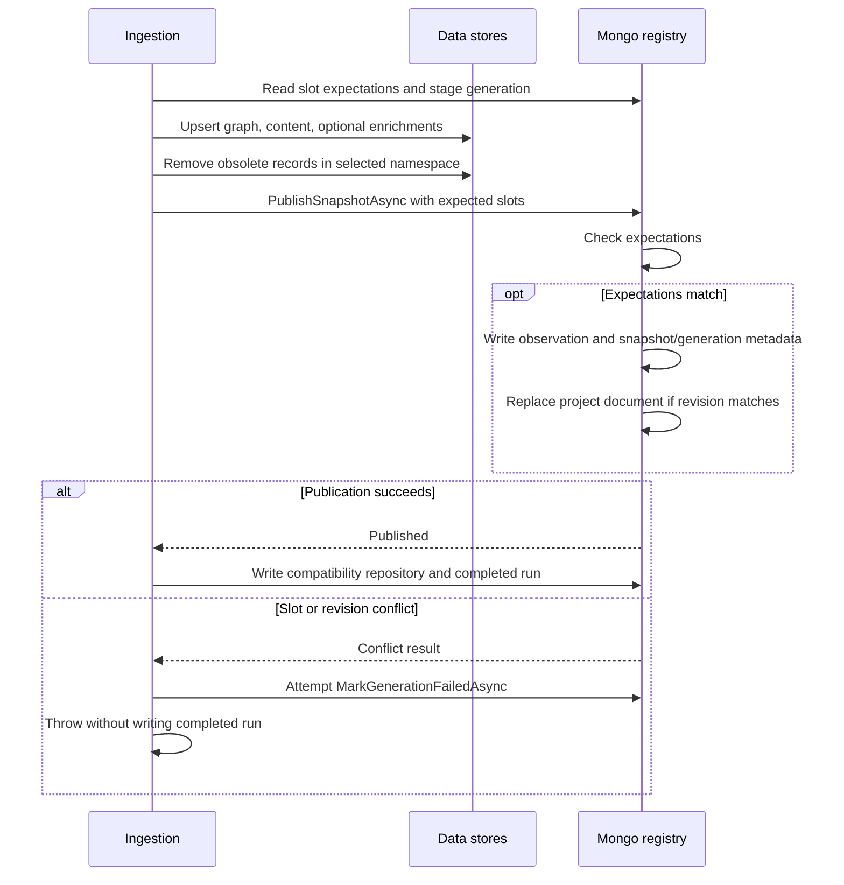
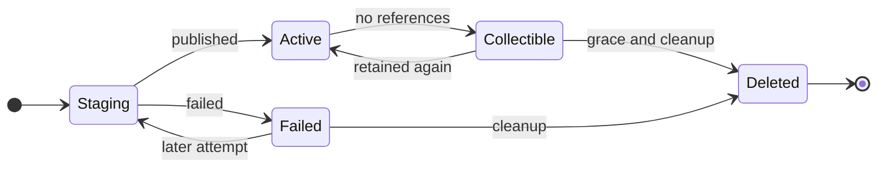

# Identity and persistence

Document type: current implementation reference

Read the [handbook glossary](../guides/developer-handbook.md#vocabulary) first.
This chapter follows
[GraphTypes.cs](../../src/CodeMesh.Domain/Graph/GraphTypes.cs),
[SnapshotContracts.cs](../../src/CodeMesh.Domain/Contracts/SnapshotContracts.cs),
and the [storage interfaces](../../src/CodeMesh.Storage/StorageContracts.cs).

## From source entities to stored records

`CodeNode` separates a parser id and stable key from its content hash. Changing
a method body can preserve its logical symbol while changing a declaration's
content. Moving a declaration can change its declaration id and span even if
the logical symbol still exists. A `CodeRelationship` names endpoint node ids,
kind, label, and metadata; these endpoint ids are parser identities, not Mongo
document ids or globally unique Neo4j keys.

C# makes the separation especially visible. A logical `Method` or `Class`
contains signature-oriented content and an unknown source span. A separate
`Declaration` contains source text and a concrete span. `Defines` points from
declaration to logical symbol. Partial declarations can therefore share one
logical symbol while retaining multiple source locations. Retrieval follows
these links to obtain readable source. See
[`ExtractDeclarationNodes` and `ExtractRelationships`](../../src/CodeMesh.Parser.CSharp/CSharpParseService.cs)
and `TestCSharpParserSeparatesPartialDeclarations` in the
[.NET harness](../../tests/CodeMesh.Tests/Program.cs).

Content is independently addressable. `CodeContent.Hash` identifies text and
`CodeNode.ContentHash` references it. Ingestion redacts text first, remaps node
hashes, and deduplicates content by the resulting hash. Consequently a content
hash is not necessarily the hash of the file on disk: it may describe a
redacted fragment or a logical symbol signature. Preserve file spans as the
navigation coordinates and the hash as stored-content identity.
[ContentRedactor](../../src/CodeMesh.Ingestion/ContentRedaction.cs) and
`TestIngestionRedactsSensitiveContentBeforeStoresAndEmbeddings` cover this
transformation.

## Project, checkout, and alias

[RepositoryIdentityService.ResolveAsync](../../src/CodeMesh.Ingestion/RepositoryIdentityService.cs)
uses private local markers. In a Git checkout, `project.json` is under the Git
common directory's `codemesh` directory and `checkout.json` under the
worktree-specific Git directory's `codemesh` directory. Linked worktrees share
the former and get separate checkout identities. Non-Git roots use
`.codemesh/project.json` and `.codemesh/checkout.json` below the selected root.

An explicit `--project-id` takes precedence over an existing project marker.
Otherwise the service uses the marker or generates a new `prj_` id. A remote
URL is recorded as provenance; it does not automatically attach separate
clones to the same project. Marker files are written through a temporary file
and replacement. This protects an individual marker write, not the entire
identity/registry operation.

For an existing checkout marker, the service looks up its registered root. If
the old root differs and still exists, it treats the marker as a live copy and
allocates a new checkout id. If the old directory has disappeared, moving the
checkout can retain its identity. The alias is retained from the project marker
or registered project before falling back to a path-derived alias.

The corresponding tests are `TestCheckoutIdentitySurvivesMovesAndRejectsLiveCopies`,
`TestLinkedWorktreesShareProjectsButNotCheckouts`, and
`TestRepositoryAliasesAreGeneratedAndResolved` in the
[.NET harness](../../tests/CodeMesh.Tests/Program.cs). Alias uniqueness is not
enforced by a global unique index; lookup code rejects ambiguity. See
[MongoRegistryStore.GetRepositoryAsync](../../src/CodeMesh.Storage/Mongo/MongoRegistryStore.cs)
and Python's
[find_repository_document](../../agent-access/codemesh_agent_access/content_store.py).

## Deterministic snapshot calculation

[`SnapshotIdentity.Compute`](../../src/CodeMesh.Ingestion/SnapshotIdentity.cs)
operates on redacted, unstamped parser output. It sorts canonical node,
relationship, and content descriptions, hashes the sequence into a source-view
hash, and combines it with the other identity dimensions:

```text
snapshot id = "snp_" + StableId(
    identity format, project id, source-view hash,
    scope fingerprint, parser-profile fingerprint, graph-schema version)
```

This is explanatory notation, not a second implementation. `StableId` is
defined in [CodeMeshHash](../../src/CodeMesh.Domain/Utilities/CodeMeshHash.cs).
Scope includes the canonical language set, repository-relative selected
solution/project paths, sorted options, and normalized path-policy fingerprint.
The parser profile includes parser name, language, redaction-profile version,
and path-policy version. It does **not** automatically hash the parser binary
or CodeMesh commit; a behavioral change may require a deliberate identity
version/profile decision.

[CodeMeshFingerprint](../../src/CodeMesh.Domain/Utilities/CodeMeshFingerprint.cs)
excludes runtime metadata such as checkout/root, commit, run id, and last-seen
time. These are stamped afterward by `RefreshMetadata`. Embeddings and
summaries are also outside core snapshot identity, so enriching an existing
snapshot does not create a new source snapshot.

Identical effective input can reuse one snapshot across commits and worktrees.
That does not promise every filesystem move yields identical parser output:
some structural parsers derive `CodeNode.Project` from the root directory name,
and that field participates in the node fingerprint. Distinguish persistence
of the project/checkout ids from stability of all parsed fields.

## Store ownership and physical keys

The .NET ingestion adapters own normal index writes. Python owns retrieval and
also exposes an explicit administrative deletion path. The
[in-memory store](../../src/CodeMesh.Storage/Memory/InMemoryCodeMeshStore.cs)
implements the same interfaces for tests, but its lock-based behavior does not
establish production MongoDB race or crash guarantees.

| Store and adapter | Records and keys | Scope, indexes, and consumers |
| --- | --- | --- |
| [Neo4jGraphStore](../../src/CodeMesh.Storage/Neo4j/Neo4jGraphStore.cs) | `CodeMeshNode` nodes and `CODEMESH_REL` relationships. `storageKey` is `snapshotId:parserId`. | Unique node storage-key constraint; indexes on code id, relationship id/storage key, repository/node id, and repository/run fields. Python [graph_store.py](../../agent-access/codemesh_agent_access/graph_store.py) must use the same key convention. |
| [MongoContentStore](../../src/CodeMesh.Storage/Mongo/MongoContentStore.cs) | Content `_id` is the content hash; text, media type, timestamps. | `repositoryIds`, `repositoryRuns`, and `repositoryLastSeenAtUtc` associate shared content with snapshot namespaces. Removal drops one reference before deleting unreferenced text. Python [content_store.py](../../agent-access/codemesh_agent_access/content_store.py) reads it. |
| [QdrantVectorStore](../../src/CodeMesh.Storage/Qdrant/QdrantVectorStore.cs) | Deterministic UUID point derived from namespace plus embedding identity; vector and searchable payload. | Payload includes node/content/provider/model and snapshot provenance. Batch dimensions must agree. Collection creation uses the first vector width and configured distance, defaulting to cosine. No custom payload indexes are created by this adapter. |
| [MongoNodeSummaryStore](../../src/CodeMesh.Storage/Mongo/MongoNodeSummaryStore.cs) | Summary `_id` includes namespace, node, content, summary kind, provider/model, prompt version, and generation fingerprint. | Unique `node_summary_identity_v2` compound index; repository/node, repository/kind/name, and repository/content-hash indexes. Python [summary_store.py](../../agent-access/codemesh_agent_access/summary_store.py) reads completed summaries and coverage. |
| [MongoRegistryStore](../../src/CodeMesh.Storage/Mongo/MongoRegistryStore.cs) | Project and checkout identity, snapshots, generations, observations, compatibility repository summaries, ingestion runs. | Mongo `_id` keys plus an embedded slot array and revision on each project. The adapter does not create a separate slot collection or additional registry indexes. |

Graph records retain the parser `id`; their `repositoryId` property is the
**snapshot namespace**, while metadata `projectId` identifies the persistent
project. Agent Access normalizes public hits to `repository_id = projectId`
and `snapshot_id = snapshotId`. Passing a public project id directly to a graph
filter without resolution will miss snapshot records. This mapping is covered
by `test_graph_storage_key_uses_repository_prefix` and
`test_context_package_uses_snapshot_namespace_for_relationships` in
[store tests](../../agent-access/tests/test_store_components.py) and
[ranking tests](../../agent-access/tests/test_context_ranking.py).

The registry's default collections are:

| Collection | `_id` and purpose |
| --- | --- |
| `snapshot_projects` | `prj_` id; alias, project revision, and all slots for that project. |
| `snapshot_checkouts` | `chk_` id; owning project, current registered root, timestamps. |
| `snapshots` | `snp_` id; source/scope/profile fingerprints, state, counts, generation and retention time. |
| `ingestion_generations` | `gen_` plus run identity; staging, published, or failed attempt. |
| `snapshot_observations` | Observation identity; checkout/snapshot/commit/branch/dirty-state association. |
| `repositories` | Persistent project id; compatibility summary and default selected-snapshot metadata. |
| `ingestion_runs` | Run id; successful completion metadata, parser/provider identity, diagnostics counts and incremental statistics. |

`MongoRegistryStoreOptions` exposes collection-name construction options, but
Python uses fixed names for the snapshot collections. Changing those defaults
requires a coordinated read/write contract change. Do not confuse constructor
customizability with an end-to-end configurable deployment surface.

## Publication order and atomicity

`IngestionOrchestrator.BuildPublicationAsync` captures expected slot snapshot
ids and versions, creates checkout-current, and adds branch-head only for a
clean named branch. Detached or dirty source can update checkout-current without
moving a clean branch-head. A generation is staged before graph/content/model
writes. All requested store operations and namespace cleanup must finish before
`PublishSnapshotAsync` is called.



The atomic operation is the final revision-checked replacement of one project
document containing its slot array. It prevents that replacement from applying
against a changed project revision and updates the requested slots together.
Neo4j writes, Mongo content updates, Qdrant writes, generation metadata, and
compatibility registry records are **not** in that atomic operation.

`MongoRegistryStore.PublishSnapshotAsync` writes observation, generation, active
snapshot, and collectible metadata before the project compare-and-swap. A
conflict can therefore leave those records ahead of the actual slot selection.
The orchestrator attempts `MarkGenerationFailedAsync` using
`CancellationToken.None`, then rethrows. Active slot selection is the primary
publication fact; a snapshot or generation state alone is insufficient.
Likewise, `WriteRegistryAsync` runs after publication, so a later registry/run
write failure can occur after slots have already changed.

The normal bound reader follows checkout-current, whereas unbound project
lookup first uses the compatibility repository summary. An explicit snapshot
selector can resolve a recorded namespace without testing whether it is active.
Thus staging is a convention enforced by the supported selection path, not an
access-control boundary around the raw stores. See
[get_bound_repository and resolve_snapshot_id](../../agent-access/codemesh_agent_access/content_store.py).

An identical snapshot can also receive optional enrichment updates in place.
There is no request-wide transaction spanning sequential reads during package
construction. Do not describe snapshots as immutable across all enrichment and
administrative operations or promise a fully atomic multi-store read.

Representative tests in the [.NET harness](../../tests/CodeMesh.Tests/Program.cs)
are `TestMultiLanguageIngestionPublishesOneDeterministicSnapshot`,
`TestSnapshotSlotsRetainCleanHeadsAndBoundDirtyHistory`,
`TestFailedSnapshotGenerationPreservesActiveSlots`, and
`TestMongoRegistryStoreRoundTripsRepositoriesAndRuns`. They protect the stated
cases, not every interleaving or process-crash point.

## Retention, pins, and deletion

The conceptual lifecycle is:



This is the intended lifecycle, with the intermediate-write limits described
above. A referenced or reused active snapshot stays active. `BuildPublicationAsync`
defaults the grace period through the CLI to
86,400 seconds and clamps negative requested values to zero.
`UpsertRetainedSlotAsync` supports `ExplicitPin` and `Evidence`; `DeleteSlotAsync`
uses an expected version and recomputes collectibility. These are registry APIs,
with tests, rather than a documented top-level pin command. A pin preserves a
snapshot; it does not verify the quality or acceptance of the evidence attached
to it.

[SnapshotGarbageCollector.CollectAsync](../../src/CodeMesh.Ingestion/SnapshotGarbageCollector.cs)
lists eligible unreferenced snapshots, then removes graph, content references,
vectors, and summaries, and finally deletes the snapshot registry record. It
collects per-snapshot non-cancellation failures so a later call can retry.
`DeleteSnapshotRecordAsync` checks for slot references again. There is no
background collector started by `RunIngestAsync`, and there is no lock covering
the whole cross-store deletion against concurrent new pins. Serialize local
cleanup with retention/publication work; a shared coordinator remains deferred.

[RepositoryCleanupService.DeleteRepositoryAsync](../../src/CodeMesh.Ingestion/RepositoryCleanupService.cs)
is broader: it enumerates every retained snapshot plus the legacy namespace,
cleans all configured stores, then removes registry state. Python's
`CodeMeshReadStore.delete_repository` implements the administrative surface
described in [Repository Delete](agent-access-contracts.md#repository-delete).
Partial cleanup is possible and exceptions do not roll back earlier deletions.
This is why deleting a repository is not a routine cure for a missing search hit.

Migration from an old absolute-path id occurs only after successful ingestion
under the new identity. The old namespace is registered as collectible with
unknown legacy fingerprints and migrated registry history; its data is not
deleted immediately. See the migration tail of `IngestAsync` and
`MongoRegistryStore.MigrateLegacyRepositoryAsync`.

For documented rationale, read
[ADR 0001](../decisions/0001-local-repository-identity-and-snapshot-publication.md).
For concrete failure diagnosis, continue to
[Development and debugging](../guides/development-and-debugging.md).
