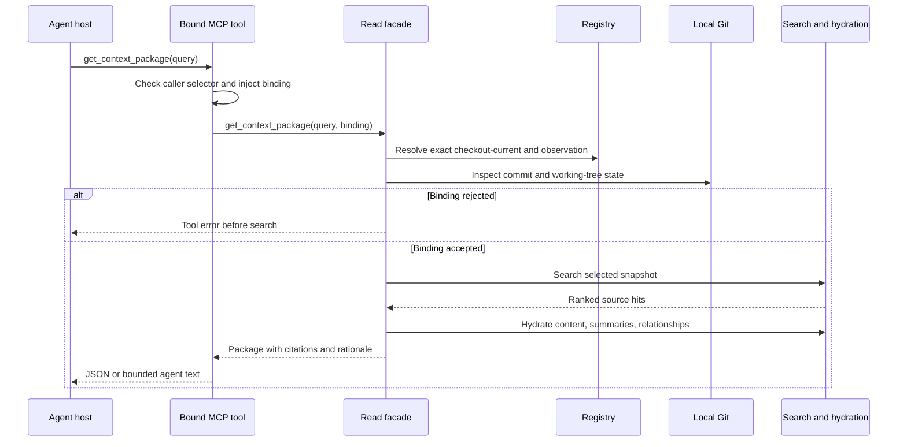

# Retrieval and Agent Access internals

Document type: current implementation reference

The central read facade is
[`CodeMeshReadStore`](../../agent-access/codemesh_agent_access/store.py).
It owns graph, content/registry, summary, query-embedding, and vector adapters.
Its methods are shared by the REST, MCP, and Python CLI surfaces. Exact request
and response fields remain in
[Agent Access Contracts](agent-access-contracts.md).

## Entry points and shared behavior

| Surface | Entry and call chain | Distinct behavior |
| --- | --- | --- |
| REST | [rest.py](../../agent-access/codemesh_agent_access/rest.py) → Pydantic request model → `CodeMeshReadStore`. | Typed HTTP JSON, FastAPI validation, unbound administrative selection; no automatic normal-MCP binding. |
| MCP | [mcp.py](../../agent-access/codemesh_agent_access/mcp.py) → [tools.py](../../agent-access/codemesh_agent_access/tools.py) → request model → read facade. | Profile allowlist, binding injection, `ToolResult` JSON envelope or text-only agent brief. |
| Python CLI | [cli.py](../../agent-access/codemesh_agent_access/cli.py) → tool/facade functions. | Local process reading stores directly; CLI formatting and explicit output budgets. |
| .NET client | [AgentAccessClient](../../src/CodeMesh.Control/AgentAccess/AgentAccessClient.cs) → REST HTTP endpoints. | Typed C# records, explicit JSON property names, URL-escaped selectors, owned or injected `HttpClient`. |
| Local UI | [web.py](../../agent-access/codemesh_agent_access/web.py) → shared read facade. | Server-generated HTML at `/ui`; read-only health, repository, run, and search views. |

The stdio MCP runtime requires a complete binding for the normal profile.
`build_server` can also be used directly by tests; the runtime requirement is
enforced by `mcp.run`. Normal exposes four tools: context package, repository
status, repository listing, and node lookup. Diagnostic adds inspection tools;
neither profile contains repository deletion. REST and the Python administrative
CLI retain deletion as a separately invoked operation.

[models.py](../../agent-access/codemesh_agent_access/models.py) defines request
types and defaults. These are ordinary typed Pydantic fields, not universally
strict bounded integers: several limits are clamped in downstream functions
rather than rejected at model construction. Do not assume all surfaces return
the same error for every malformed value. `test_rest_contract.py`,
`test_mcp_contract.py`, and `test_cli_output.py` under
[tests](../../agent-access/tests/) protect surface-specific mapping.

## Repository and snapshot resolution

An unbound query may supply a project id, alias, explicit snapshot id, or slot
key. `_resolve_repository_id` first reads a compatibility repository summary
and uses its selected snapshot metadata. If that fails to identify a repository,
`MongoContentStore.resolve_snapshot_id` tries an explicit snapshot record, then
matching slot keys. Ambiguous aliases and slot matches raise errors. Certain
Mongo errors return the original selector or no match, so an empty result can
also be a store availability symptom.

The bound path is intentionally more specific.
[`RepositoryBinding`](../../agent-access/codemesh_agent_access/binding.py)
requires project id, checkout id, and an absolute root; it optionally includes
source-view hash. `bound_repository_reference` permits omitted selection or the
configured project/checkout id and rejects conflicting overrides. It does not
accept arbitrary aliases as equivalent to a bound identity.

[`MongoContentStore.get_bound_repository`](../../agent-access/codemesh_agent_access/content_store.py)
reads the registered checkout, verifies its project, selects exactly its
`CheckoutCurrent` slot from `snapshot_projects`, reads that snapshot, and finds
the latest observation for that project/checkout/snapshot. `bound_repository_document`
builds a summary from these records rather than trusting the compatibility
summary's default branch selection. Missing or ambiguous state cannot produce
an accepted bound package.

`test_bound_repository_document_uses_exact_checkout_slot`,
`test_binding_assessment_requires_exact_identity_root_and_freshness`, and
`test_context_package_rejects_unaccepted_binding_before_search` in
[test_store_components.py](../../agent-access/tests/test_store_components.py)
protect the critical order. The latter asserts that rejection happens before
the search path is used.

## What freshness actually checks

[`_repository_freshness`](../../agent-access/codemesh_agent_access/store.py)
captures local Git state in a worker thread. It compares indexed and current
commits, selected versus observed snapshot ids, and indexed versus current dirty
state. Any current or indexed dirty view is unverifiable for normal access and
therefore stale. If Git/root/commit provenance is unavailable, freshness is
unknown rather than accepted.

`assess_binding` additionally checks project, checkout, normalized root, optional
configured source-view hash, fresh status, `is_stale is False`, and known
provenance. `require_accepted_binding` raises `RepositoryBindingError` for a
rejected assessment. Node reads through a bound MCP server apply the same
freshness gate; administrative unbound reads do not inherit that gate.

This does not reparse source or recompute `SnapshotIdentity.SourceViewHash` on
every request. The source-view comparison uses recorded identities and Git
observations. Ignored source changes and edits concurrent with the read are not
covered by a full filesystem read transaction. Freshness acceptance is the
implemented local check at that moment, not a perpetual guarantee about bytes
an agent reads later. See [inspection findings](../guides/development-and-debugging.md#inspection-findings).

`get_repository_status` also returns stored counts, the latest available run,
summary coverage, and `_refresh_status`'s interpretation of that run. It does
not continuously observe the running .NET process. In particular, the
orchestrator writes its completed run record after successful work; parser
exceptions can occur without a new failed run appearing in this API.

## Search candidate acquisition

`search_context` resolves scope first, then optionally embeds the text query if
an explicit vector was not supplied and the query provider is enabled. It
starts vector, lexical, and summary tasks concurrently when their inputs exist.
That is concurrency across search sources, not parallel hydration of every
candidate. Model-free mode skips query embedding, but still allows lexical
search and lookup of previously stored summaries.

The graph adapter's
[`search_context_nodes`](../../agent-access/codemesh_agent_access/graph_store.py)
uses query terms against stored symbol/path/metadata fields. This lexical search
is not full-text search over Mongo source bodies. `_search_lexical_context`
requests up to `min(max(limit * 16, 64), 500)` raw nodes, applies exact filters,
scores them, and diversifies to `min(max(limit * 4, 16), 200)` candidates before
constructing context hits. This bounded pool means a relevant node outside the
acquired candidates cannot be rescued by changing the final sort alone.

Vector search uses
[`QdrantSearchClient`](../../agent-access/codemesh_agent_access/vector_store.py)
and exact payload filters, then looks up the corresponding graph nodes and
builds expanded hits. Summary search uses
[`MongoNodeSummaryStore`](../../agent-access/codemesh_agent_access/summary_store.py)
to find completed generated summaries and turn their relevance into candidates.
`_candidate_limit` bounds those retrieval pools. Diagnostics distinguish raw
candidate counts from counts contributing to the final returned hits.

## Ranking, expansion, and file coverage

`_lexical_score` compares the full normalized query to id, stable key, name,
path, language, signature/display, and native export/attribute metadata. Exact,
prefix, and substring matches take explicit early scores. Otherwise
`lexical_terms` removes common grammatical noise and splits language-specific
identifiers, and scoring combines overall term coverage, best-field coverage,
symbol/filename coverage, and semantic-metadata coverage. Small inflection
variants help queries such as a plural noun match singular identifiers.

These are hand-written relevance heuristics, not calibrated probabilities.
`_adjust_score` multiplies raw relevance by a node-kind weight, adds an expansion
bonus, and clamps to `[0, 1]`. `_ranked_unique_hits` retains the best hit per
`node_id` and merges source score components; it does not sum all source scores
into one universal relevance estimate. It sorts by adjusted score, highest raw
source relevance, kind weight, and earlier source line. The raw tie-break is
important when adjusted scores saturate at 1.

Low-signal nodes such as parameters can expand to useful containing context.
`_select_context_node` obtains graph candidates, `_choose_context_candidate`
prefers relevant kinds with a distance penalty, and `_build_context_hit`
attaches a primary source declaration. A hit can consequently retain a logical
method id while taking the path/span/content from its declaration. Its
`expanded_context` explains the source, selected node, declaration, and reason.
Without that distinction, a debugger may wrongly treat a method's zero span as
missing source.

After deduplication, `_diversify_ranked_hits` groups hits by normalized file path
and takes one item per file per round. This can put a lower-scoring hit from a
new file ahead of the second hit in a high-scoring file. The behavior applies to
context search as well as packages; symbol search is a separate path with its
own scoring and optional declaration attachment.

Representative evidence in
[test_context_ranking.py](../../agent-access/tests/test_context_ranking.py):

- `test_vector_search_expands_parameter_declaration_to_method_context` and
  `test_vector_search_can_disable_context_expansion` isolate expansion.
- `test_lexical_score_ranks_multi_term_coverage` and
  `test_lexical_score_uses_language_signature_and_inflection_for_native_boundary`
  protect task and native-boundary matching.
- `test_ranked_hits_break_saturated_scores_with_raw_relevance` protects the
  saturated-score tie-break.
- `test_ranked_hits_cover_distinct_files_before_repeating` and
  `test_lexical_candidates_cover_distinct_files_before_repeating` protect both
  stages of file diversity.

Unscoped searches deduplicate by parser node id, not `(snapshot_id, node_id)`.
Scope retrieval to the intended repository/snapshot when inspecting repeated
symbols across multiple indexes. Normal bound MCP supplies that scope.

## Package hydration and budget allocation

`get_context_package` calls context search with expansion enabled and search-stage
relationship inclusion disabled. It optionally loads repository/run metadata,
then hydrates each returned hit **sequentially** through
`_hydrate_context_package_item`. For each item it reads node/content, falls back
to the hit's content hash when necessary, looks up a completed summary, and
collects grouped relationship summaries if requested. Every graph lookup uses
the hit snapshot or resolved query namespace.

Hydration completes before snippet allocation. The assembly loop divides the
remaining character allowance by the remaining item count, extracts/trims a
snippet, and carries unused allowance forward. Content metadata deliberately
omits the full stored text; `snippet` is the budgeted source output. The
structured `max_characters` budget counts emitted snippets, not JSON overhead,
relationship rows, summaries, or metadata. `total_snippet_characters` reports
that sum.

`_snippet_for_hit` conditionally slices by line numbers when they fit within the
loaded content, then `_trim_text` applies a marker within the budget. Source
fragments can have file-absolute spans, so this conditional slicing has a known
edge case described in [Inspection findings](../guides/development-and-debugging.md#inspection-findings).
For a suspect snippet, inspect the declared path/span and content hash instead
of assuming trimming proves the source is absent.

MCP agent mode formats the package using
[`format_context_package_for_agent`](../../agent-access/codemesh_agent_access/formatting.py)
and caps the **whole formatted brief** at 12,000 characters or the caller's
smaller allowance. It returns one `TextContent` in `CallToolResult`, with no
structured duplicate. JSON mode returns the complete structured package through
the tool envelope. Python CLI agent output honors its explicit budget without
the MCP-only ceiling. Character limits are not token-count guarantees.

`test_context_package_includes_snippet_relationships_and_registry_metadata` in
[ranking tests](../../agent-access/tests/test_context_ranking.py), plus
[formatting tests](../../agent-access/tests/test_formatting.py) and
[CLI tests](../../agent-access/tests/test_cli_output.py), protect these separate
budgets and output forms.

## Relationship evidence and validation suggestions

`_get_context_relationship_summaries` reads local graph relationships and
normalizes the opposite node's identity, kind, name, and source span.
`_prioritize_context_relationships` orders useful edges and applies group/total
limits. Incoming `Invokes` populate callers; outgoing `Invokes` populate callees;
other groups expose reads, writes, containment, definitions, and type uses.
These directional groups support likely impact navigation, but limits can omit
edges and heuristic parsers can omit or misresolve dependencies.

The recommendation builder, `_validation_recommendations`, inspects packaged
file paths and whether the repository alias identifies CodeMesh. It suggests
known .NET, Agent Access Python, Rust, deployment, smoke, and Markdown checks,
with reasons and applicable paths. It does not run commands, inspect all target
build configurations, or infer a complete transitive test-coverage graph. Use
the target repository's own instructions to choose and authorize validation.

`test_context_relationship_prioritization_prefers_agent_useful_edges` and
`test_context_relationship_prioritization_applies_group_limits` in
[ranking tests](../../agent-access/tests/test_context_ranking.py) cover selection.
The canonical command policy remains [COMMANDS.md](../../COMMANDS.md) and
[Testing](../evaluation/testing.md).

## Failure interpretation and instrumentation

| Observation | Code path and interpretation |
| --- | --- |
| MCP binding error | `bound_repository_reference`, `assess_binding`, or `require_accepted_binding`; search may not have started. Use status for the precise issues. |
| HTTP validation error | FastAPI/Pydantic could not construct a request; examine the surface schema before debugging ranking. |
| Empty hits | Scope, path/kind filters, bounded candidate acquisition, parser omissions, or adapter fallback. Check store health and diagnostics. |
| `lexical_fallback=true` | A vector existed but contributed no returned hits; this is narrower than every possible query-provider failure. |
| Empty snippet with metadata | Content excluded, absent, hash fallback missed, or character allowance exhausted. |
| Unknown freshness | Local Git/root or indexed provenance unavailable. A healthy container alone cannot verify a host path. |
| Raised adapter/normalization exception | Not all exceptions become empty responses. REST has no uniform custom error envelope for every facade failure. |

Mongo and graph adapters catch selected dependency errors and can yield no data;
query embedding catches HTTP errors and returns no vector. Such behavior allows
some degraded reads but does not make all stores optional or guarantee every
failure becomes a graceful lexical fallback. The model-free development profile
still uses graph/content/registry stores for live retrieval.

The opt-in `_ContextPackageTiming` records repository resolution, search,
metadata, item hydration, assembly, and individual hydration operations through
a sanitized sideband. It emits even on failure and does not alter the response
budget or ranking. `test_context_package_emits_sanitized_stage_timings_with_injected_delays`
in [ranking tests](../../agent-access/tests/test_context_ranking.py) uses a
controlled clock to verify stage attribution. Live evaluation aggregates
measured calls separately from warm-ups. Follow
[the evaluation guide](../evaluation/mcp-effectiveness.md) before collecting
live timings; a timing result is not retrieval-quality evidence.
