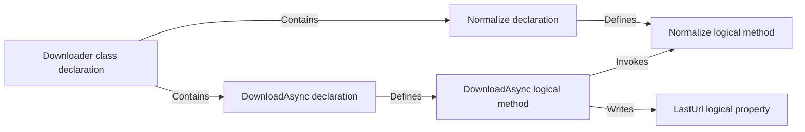

# Three developer walkthroughs

Document type: source-traced developer guide

These walkthroughs follow the inspected implementation recorded in the
[handbook](developer-handbook.md). They were not executed as live ingestion or
retrieval during the handbook review. Paths, `P`/`C`/`S` identities, and command
variables below are illustrative placeholders; no counts, exact ranks, hashes,
or provider results are asserted.

The running source example is checked in inside
[`scripts/e2e-smoke.ps1`](../../scripts/e2e-smoke.ps1), function `New-SmokeFixture`.
It creates a temporary `CodeMeshSmokeFixture.csproj` targeting .NET 10 and a
`Downloader.cs` file. `Downloader.DownloadAsync` assigns
`LastUrl = Normalize(url)` and returns a completed task containing `download:`
followed by `LastUrl`;
`Normalize` trims and lowercases its input. The script initializes and commits
the fixture repository. This source is small enough to follow both a method
call and a property write without requiring a private sample checkout.

Running the full smoke script starts local services and writes disposable store
state. Use the [Testing guide](../evaluation/testing.md#end-to-end-smoke) when
that work is intended. Reading these traces requires no running service.

## Walkthrough 1: ingest and publish a small repository

### Entry and parser selection

After preparing a disposable copy of the script's fixture, an illustrative
invocation is the following. Shell: PowerShell. Working directory: the CodeMesh
repository root. It uses the supported ingest pattern in
[MCP Setup](mcp-setup.md#ingest-a-repository); the selected path must exist and
store endpoints must point at the intended local environment.

```powershell
$fixtureRoot = "C:\path\to\prepared-smoke-fixture"
$fixtureProject = Join-Path $fixtureRoot "CodeMeshSmokeFixture.csproj"
dotnet run --project src/CodeMesh.Cli -- ingest `
  --root $fixtureRoot `
  --project $fixtureProject `
  --skip-embeddings `
  --json
```

[Program.cs](../../src/CodeMesh.Cli/Program.cs) dispatches `ingest` to
`RunIngestAsync`, resolves the repository and project, normalizes default C#
language, and constructs a local `CSharpParseService` client unless a parser URL
was configured. It constructs Neo4j, Mongo content/registry/summary, and Qdrant
adapters. Embeddings are skipped and summaries are not included.

`IngestionOrchestrator.IngestAsync` captures Git provenance, resolves persistent
project `P` and checkout `C`, and creates a `ParseRequest`. These markers live
under the fixture's Git metadata, not in `Downloader.cs`. The parser receives
the root, selected project, language, options, and path filter.

### Source to graph

[`CSharpParseService.LoadProjectContextsAsync`](../../src/CodeMesh.Parser.CSharp/CSharpParseService.cs)
loads the explicit project through MSBuildWorkspace. The supported path uses
its compile items and compilation; if loading fails and fallback is used,
diagnostics describe the weaker source context.

`ParseAsync` emits the file, then all logical symbols and declarations, then
relationships. For this fixture, the relevant transformation is:



This diagram is a selected subset of the graph, not the full emitted node/edge
count. Above the class, `Contains` connects the file to the namespace declaration
and that namespace to the class declaration. `ExtractDeclarationNodes` gives
source declarations concrete spans and
content hashes, while logical symbols use stable symbol keys and signature
content. `AddBodyReferenceRelationships` resolves the local call to `Normalize`
and the property assignment. Framework calls such as `Task.FromResult` are not
guaranteed to have indexed target nodes.

### Graph to published selection

The orchestrator rejects parser error diagnostics, redacts the returned text,
remaps changed hashes, and computes source snapshot `S0`. It stamps
`repositoryId=S0` for storage alongside `projectId=P` and `checkoutId=C` in
metadata. Public `IngestionResult.Repository.Id` remains `P`.

For a first snapshot, there are no existing records to skip. `BuildPublicationAsync`
captures expected checkout-current and clean branch-head slots and stages
generation `G0`. `Neo4jGraphStore.UpsertGraphAsync` creates endpoint nodes before
relationships using snapshot-prefixed storage keys. Mongo content upserts text
by hash and adds references to `S0`. No model request is made by the skipped
embedding or omitted summary path.

After namespace cleanup, `MongoRegistryStore.PublishSnapshotAsync` checks slot
expectations and revision-replaces the project's slot document. Successful
publication selects `S0` for checkout `C` and its clean named branch. The final
`WriteRegistryAsync` writes compatibility metadata and the completed ingestion
run/statistics. The exact partial-failure boundaries are in
[Identity and persistence](../current/identity-and-persistence.md#publication-order-and-atomicity).

### Branches and evidence to inspect

| Branch | Expected source behavior | Supporting tests |
| --- | --- | --- |
| `--dry-run` | Parse/redact/count without persistent markers, writes, generation, or model calls. | `TestDryRunSkipsStores`. |
| Parser error | Abort before staging/publication; CLI returns an error. | `TestMultiLanguageIngestionPublishesOneDeterministicSnapshot` includes parser-failure coverage. |
| Graph write fails after staging | Attempt to mark generation failed; previous slots survive. | `TestFailedSnapshotGenerationPreservesActiveSlots`. |
| Identical repeat ingest | Same effective snapshot, with unchanged records skipped. | `TestIncrementalIngestionSkipsUnchangedRecords`, `TestSnapshotSlotsRetainCleanHeadsAndBoundDirtyHistory`. |
| Redaction changes text | Remap hashes before content and provider use. | `TestIngestionRedactsSensitiveContentBeforeStoresAndEmbeddings`. |

These named tests live in the [.NET harness](../../tests/CodeMesh.Tests/Program.cs).
The smoke script adds real adapter and REST coverage when deliberately run;
its `Invoke-JsonCommand` and later relationship/context checks show how it
observes the result. A unit fixture pass alone does not prove store publication.

## Walkthrough 2: retrieve a context package

### Start at a supported bound entry point

Assume a reviewed normal-profile installation binds project `P`, checkout `C`,
the fixture's absolute root, and optionally `S0`'s source-view hash. The source is
still clean at its indexed commit. Installation is performed through
[MCP Setup](mcp-setup.md#repository-agent-onboarding); it is not a side effect of
retrieving context.

Illustrative MCP call to `codemesh_get_context_package`:

```json
{
  "query": "DownloadAsync normalization and LastUrl update",
  "output_format": "agent"
}
```

This example asserts no particular rank. The omitted selector uses the server's
binding; it does not search every repository.

### Resolve and verify before searching

The registered wrapper in
[`mcp.build_server`](../../agent-access/codemesh_agent_access/mcp.py) checks the
caller selector, forwards the binding through
[`tools.get_context_package`](../../agent-access/codemesh_agent_access/tools.py),
and constructs a `ContextPackageQuery` for
[`CodeMeshReadStore.get_context_package`](../../agent-access/codemesh_agent_access/store.py).

The facade calls `get_repository_status` with the binding. Mongo
`get_bound_repository` resolves `C`'s checkout-current slot and observation,
then `_repository_freshness` compares recorded provenance to local Git state.
`assess_binding` requires exact identities/root and acceptable freshness. A
rejected assessment throws before `search_context`. On acceptance, the package
query's `repository_id` becomes the exact snapshot namespace `S0`.

### Search and transform hits

With query provider mode `none`, `search_context` starts lexical graph and
stored-summary search without a model request. With no generated summaries,
lexical results provide the candidates. The graph query acquires matching
symbol/path/metadata rows; `_lexical_score` evaluates query-term coverage;
candidate diversification prevents one file from consuming every candidate
when alternatives exist.

`_build_context_hit` attaches a source declaration to a logical method where
available. For a `DownloadAsync` hit, the logical node identity can remain the
method while the hit's span and hash point to its source declaration. The
selected source path is `Downloader.cs`; its exact line numbers come from the
actual prepared fixture, not this guide.

`_ranked_unique_hits` deduplicates parser node ids, resolves relevance ties, and
diversifies by file. The tiny fixture has few distinct files, so do not expect
the multi-file diversity examples from larger evaluation suites to appear here.

### Hydrate, allocate, and format

For each hit, `_hydrate_context_package_item` calls `get_node` in `S0`, obtains
content, falls back to the hit hash if necessary, reads an optional completed
summary, and reads useful relationships. An outgoing `Invokes` edge to
`Normalize` can become a callee; the write to `LastUrl` can appear in the writes
group. Group/total limits and the selected hit determine what is included.

The assembly loop allocates remaining snippet characters across remaining
items. The response carries public project provenance, snapshot/content
identity, source span, rank and score components, and heuristic validation
suggestions. `format_context_package_for_agent` turns it into a brief. The MCP
wrapper caps the entire brief and returns a single text block, avoiding a
duplicate structured copy. Choosing `output_format=json` instead returns the
structured package, where `max_characters` constrains snippets rather than
total serialized size.

Follow the returned source spans into the checkout before concluding that a
change is safe. A bounded package is a selection of evidence, not the full
call graph or a completed test run.

### Supporting tests and alternate entry points

`test_context_package_rejects_unaccepted_binding_before_search` in
[test_store_components.py](../../agent-access/tests/test_store_components.py)
protects the gate. `test_context_package_includes_snippet_relationships_and_registry_metadata`
and `test_context_package_uses_snapshot_namespace_for_relationships` in
[test_context_ranking.py](../../agent-access/tests/test_context_ranking.py)
protect assembly and namespace selection. The
[MCP](../../agent-access/tests/test_mcp_contract.py) and
[formatting](../../agent-access/tests/test_formatting.py) tests protect delivery.

REST `/context/package` and the .NET client's `GetContextPackageAsync` enter the
same facade through HTTP and the canonical request model, but do not supply the
normal MCP binding. They therefore share ranking/assembly while retaining their
unbound selection behavior. The Python CLI also reads stores directly. The
[retrieval chapter](../current/retrieval-internals.md) explains these differences.

## Walkthrough 3: refresh changed source and handle stale access

### A dirty edit before refresh

Starting from `S0`, suppose the developer changes `Normalize`'s implementation.
Until refresh, the stores still contain the older source. A normal bound package
checks Git status, reports stale, and rejects retrieval. It does not invoke
ingestion automatically. The agent can continue direct source inspection while
the developer decides how to update the index.

Even after a dirty-source refresh publishes a new checkout-current snapshot,
normal MCP still rejects the dirty view. This is deliberate freshness behavior:
the read path cannot verify arbitrary working-tree contents by commit alone.
Administrative status/read surfaces can inspect it with their documented scope.

### Refresh uses the same pipeline

Illustrative command, PowerShell from the CodeMesh root, retaining the prepared
fixture variables from walkthrough 1:

```powershell
dotnet run --project src/CodeMesh.Cli -- refresh `
  --root $fixtureRoot `
  --project $fixtureProject `
  --skip-embeddings `
  --json
```

[`RunRefreshAsync`](../../src/CodeMesh.Cli/Program.cs) calls
[`CodeMeshRefreshWorkflow.ResolveTarget/BuildRefreshIngestArgs`](../../src/CodeMesh.Control/Configuration/CodeMeshRefreshWorkflow.cs),
then `RunIngestAsync`. No distinct refresh parser runs. The C# parser reads the
selected project again, the changed file/declaration hashes change the source
view, and the orchestrator stages snapshot `S1` under the same project/checkout.

For a dirty checkout, publication moves checkout-current `C → S1` and preserves
the clean branch-head `main → S0`. If another dirty refresh produces `S2`, `S1`
becomes collectible only when no pin/evidence/other slot references it; collection
must then wait for its grace period. This does not delete `S0` while branch-head
retains it.

If the developer commits the exact source that produced `S1` and refreshes,
the source snapshot can be reused while the new observation records the clean commit.
Branch-head can then move to `S1`. Commit identity is observation data rather
than a component of the source snapshot hash. Bound freshness can accept that
clean observation, provided all binding dimensions match. If installation pinned
the old source-view hash, a reviewed binding update and probe are also needed;
refresh does not silently rewrite host configuration.

### A store failure during refresh

For a separate failure branch starting from published `S0`, suppose the changed,
committed fixture parses successfully, but a graph write throws after staging.
`IngestAsync` catches the failure inside its persistent
write block, calls `MarkGenerationFailedAsync`, and rethrows to the CLI. The old
slots still point at `S0`; partial data for the new namespace can remain.
Because the checkout commit has changed, normal bound access to the old
observation remains stale. A reachable service and old successful run do not
mean the failed refresh was accepted.

Inspect CLI diagnostics, the selected slot/observation, and store health. After
the store issue is resolved, an intentional refresh can reuse deterministic
identity and reconcile partial writes. Garbage collection is a separate local
API operation; it is not automatically scheduled by refresh. Concurrent pin/
publication/cleanup guarantees are limited as described in
[Identity and persistence](../current/identity-and-persistence.md#retention-pins-and-deletion).

### Watch variant and evidence

Watch performs the initial ingest, then
[`CodeMeshWatchWorkflow.CreateSnapshot`](../../src/CodeMesh.Control/Configuration/CodeMeshWatchWorkflow.cs)
compares eligible paths, file sizes, and write timestamps. On a change it runs
the same ingestion arguments. Git metadata-only changes may not trigger it;
use explicit refresh after such changes. A thrown ingest error terminates this
watch path rather than retrying forever.

`TestSnapshotSlotsRetainCleanHeadsAndBoundDirtyHistory` uses a temporary Git
repository and controllable parser output to exercise clean/dirty retention and
snapshot reuse. `TestFailedSnapshotGenerationPreservesActiveSlots` injects a
`FailingGraphStore`. `TestWatchWorkflowDetectsFileChanges` and the argument
normalization tests cover polling and option preservation. All live in the
[.NET harness](../../tests/CodeMesh.Tests/Program.cs). Python's binding/freshness
tests cover the rejection side; these are complementary invariants, not a claim
that this illustrative sequence was run end to end during documentation review.
